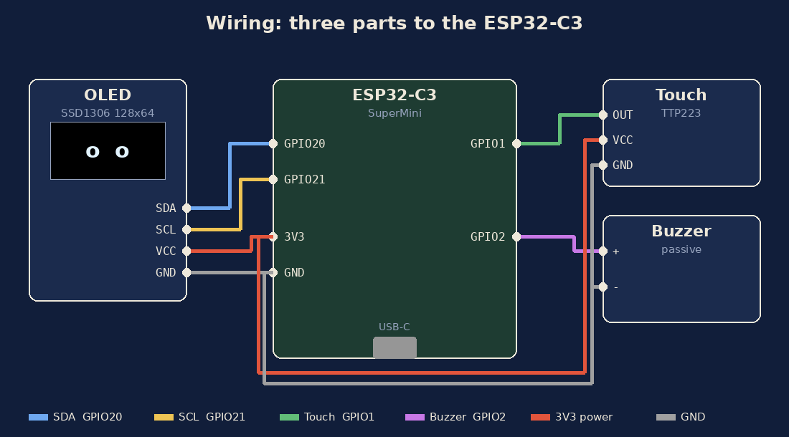
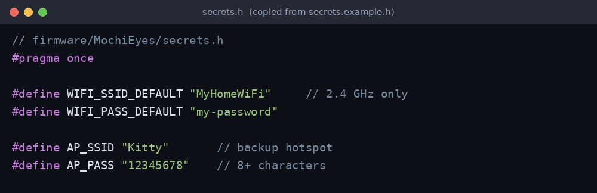
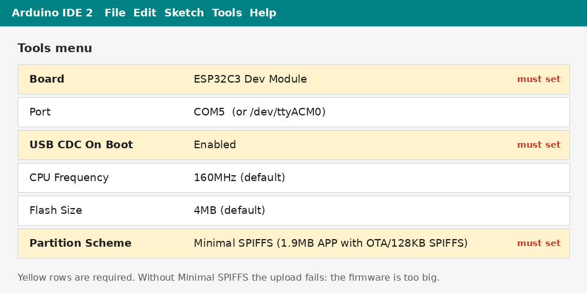
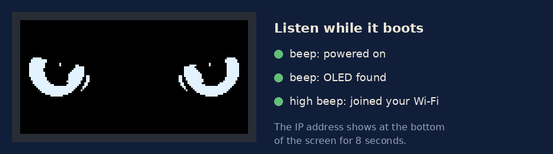
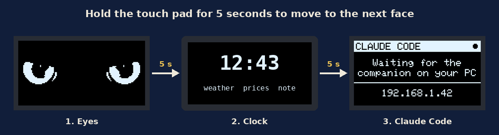
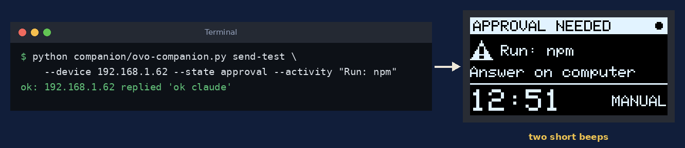
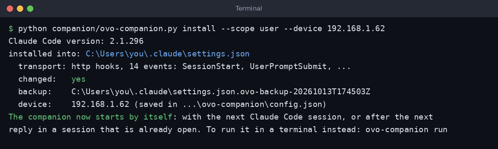
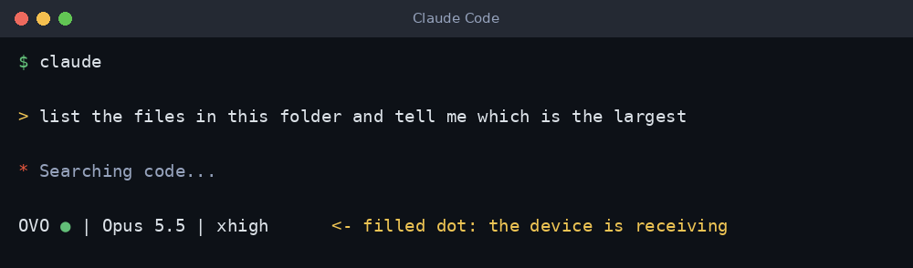
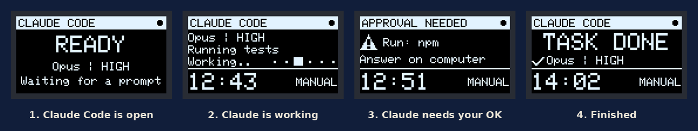
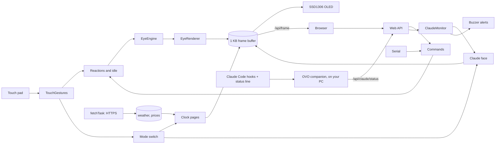

<div align="center">


# OvO with Claude code

**A desk companion for the ESP32-C3: lifelike eyes that react to touch, a clock, weather and prices terminal, and a Claude Code activity monitor, on one 128×64 OLED.**

[](https://github.com/satyaidk/MochiEyes/actions/workflows/ci.yml)
[](docs/HARDWARE.md)
[](https://github.com/espressif/arduino-esp32)
[](tests/host/test_touch.cpp)
[](companion/README.md)
[-100%25-2f6f4f)](docs/adr/0005-arduino-free-touch-gesture-recognizer.md)
[](LICENSE)

[**User manual**](#user-manual-step-by-step) · [Getting started](#getting-started) · [Usage](#usage) · [Architecture](#architecture) · [Claude Code monitor](docs/CLAUDE_MONITOR.md) · [Design](docs/DESIGN.md) · [API](docs/API.md) · [Learning path](docs/LEARNING_PATH.md)


<sub>Frames rendered by the firmware's own eye engine (<code>tools/preview/frames.cpp</code>), shown at 3× scale.</sub>

</div>

## Overview

MochiEyes turns an ESP32-C3 SuperMini, an SSD1306 OLED, a touch pad and a
buzzer into a small character that lives on a desk. Most of the time the
screen shows a pair of eyes driven by a behaviour engine modelled on human eye
movement data: saccades, blinks, microsaccades and moods. Touch the pad and
the eyes respond. Hold it for five seconds and the screen slides over to a
clock with weather, crypto prices and a note you write from your phone. Hold
it again for a Claude Code monitor: a small companion on your computer
reports what Claude Code is doing, and the device shows the model and effort,
the current action, the elapsed time and the approval mode, and beeps when
Claude Code needs your permission.

The firmware merges two earlier programs, an info terminal and an eyes-only
sketch, into one. A Japanese-styled web controller lets you steer the gaze,
set the mood and watch a live copy of the OLED from any browser on the same
network.

## Key features

- **Touch reactions.** 1 tap: glances toward the pad. 2 taps: smiles.
  3 taps: grumpy side-eye. 4 or more: dizzy, with the eyes orbiting in opposite
  directions. Hold: enjoys being petted. Hold 5 s: next face.
- **Three faces, one screen.** Eyes, clock pages and Claude Code, cycled with a
  shoji-door transition and an on-screen hold progress bar.
- **Claude Code monitor.** Model and effort, activity ("Running tests",
  "Editing code"), task timer, approval mode, and distinct screens for
  approval needed, turn done, task done, failed, stale and disconnected.
  Built on Claude Code's supported hooks and status line, never terminal
  scraping, and read-only: it cannot approve or deny anything
  ([details](docs/CLAUDE_MONITOR.md)).
- **Alerts.** Two beeps when Claude Code asks for permission, a tone when a
  task finishes, a warning on failure; each switchable, none blocking.
- **Alive while busy.** HTTPS downloads run in a FreeRTOS task, so the eyes
  never freeze during network requests.
- **Auto-sleep.** Drowsy after 2 minutes alone, asleep after 5; any tap wakes
  it up.
- **Web controller.** Ensō gaze pad, mood and face seals, touch-gesture tester,
  clock pages, note editor, settings and live status, in light and dark themes.
- **Live OLED mirror.** The browser shows the device's actual frame buffer,
  even when no OLED is connected.
- **One command language** for the web page, the Serial Monitor and scripts
  ([API](docs/API.md)).
- **Fits the C3.** 69% of a 1.9 MB app partition, 14% of RAM for globals.

## Demo

<table>
  <tr>
    <td width="70%"></td>
    <td width="30%" rowspan="2"></td>
  </tr>
  <tr>
    <td></td>
  </tr>
</table>

Screenshots of the real page served by `tools/preview/serve.py`, with the
mirror playing frames from the eye engine (light, phone) and from the Claude
screen renderer (dark). On the device, the same page is served from flash at
`http://mochi.local`.

**Claude Code face.** Every screen state, drawn by the firmware's screen code
with the real Adafruit GFX library on a PC (`tools/preview/claude_screens.cpp`),
3× scale:

<p align="center"></p>

## User manual: step by step

New to OvO? Follow these steps in order. Each step says what to do and what
you should see before you move on. If a step doesn't look like the picture,
fix it before going to the next one: later steps depend on it.

| Part | Steps | Time |
| ---- | ----- | ---- |
| [A. Build the device](#a-build-the-device) | 1 to 5 | about 30 min |
| [B. Use the device](#b-use-the-device) | 6 to 7 | 5 min |
| [C. Connect Claude Code](#c-connect-claude-code-optional) (optional) | 8 to 12 | about 10 min |

### A. Build the device

#### Step 1. Get the parts and software

| You need | Notes |
| -------- | ----- |
| ESP32-C3 SuperMini | Any ESP32-C3 board with 4 MB flash works |
| SSD1306 0.96" OLED, 128×64, I2C | 4 pins: GND, VCC, SCL, SDA |
| TTP223 touch module | Any capacitive touch module whose output goes HIGH when touched |
| Passive buzzer | Not an active buzzer: an active one only clicks |
| USB-C data cable, jumper wires | Some cables only charge: use one that carries data |
| A 2.4 GHz Wi-Fi network | The ESP32-C3 cannot join 5 GHz networks |
| [Arduino IDE 2.x](https://www.arduino.cc/en/software) | On Windows, macOS or Linux |

#### Step 2. Wire the parts

Connect the parts with the board **unplugged**:

<p align="center"></p>

| From | To ESP32-C3 |
| ---- | ----------- |
| OLED SDA | GPIO 20 |
| OLED SCL | GPIO 21 |
| Touch OUT | GPIO 1 |
| Buzzer + | GPIO 2 |
| OLED VCC, touch VCC | 3V3 |
| OLED GND, touch GND, buzzer − | GND |

Put the touch pad on the **left** of the screen as you face it. If the board
doesn't start with the buzzer connected, read the GPIO2 note in
[docs/HARDWARE.md](docs/HARDWARE.md#pin-notes).

#### Step 3. Set up the Arduino IDE

1. Open **File → Preferences**. Under **Additional boards manager URLs**, paste
   `https://espressif.github.io/arduino-esp32/package_esp32_index.json`.
2. Open **Tools → Board → Boards Manager**, search for `esp32`, and install
   **esp32 by Espressif Systems**, version **3.3.12**.
3. Open **Tools → Manage Libraries** and install:
   **Adafruit SSD1306** (2.5.17), **Adafruit GFX Library** (1.12.6) and
   **ArduinoJson** (7.4.3). If the IDE asks to install dependencies too, say yes.

#### Step 4. Download the code and add your Wi-Fi

1. Download this repository: **Code → Download ZIP** on GitHub and unzip it,
   or run `git clone https://github.com/satyaidk/ovo-claude.git`.
2. In `firmware/MochiEyes/`, make a copy of `secrets.example.h` and name it
   **`secrets.h`**.
3. Open `secrets.h` and put in your Wi-Fi name and password:

<p align="center"></p>

`secrets.h` is git-ignored, so your password never ends up on GitHub.
Optional: at the top of `MochiEyes.ino` you can set your time zone
(`TZ_STRING`), your name for the greeting (`OWNER_NAME`), and `TOUCH_SIDE`
(`+1` if the pad is on the right).

#### Step 5. Upload to the board

1. In the Arduino IDE, open **`firmware/MochiEyes/MochiEyes.ino`**.
2. Plug the board in with the USB cable.
3. In the **Tools** menu, set these values. The three yellow rows are
   required:

<p align="center"></p>

4. Click **Upload** (the → arrow) and wait for **Done uploading**.

**You should hear** three beeps and **see** the eyes open. For 8 seconds the
bottom of the screen shows the device's IP address. Write it down: you'll
need it later.

<p align="center"></p>

| If | Do this |
| -- | ------- |
| The upload fails with "Sketch too big" | Set **Partition Scheme** to **Minimal SPIFFS** (step 5.3) |
| The screen stays dark | Check the SDA/SCL wires. A long low beep means the OLED wasn't found |
| There's no high beep (Wi-Fi) | Check `secrets.h`. The device then opens its own hotspot, **Kitty** (password `12345678`): join it and open `http://192.168.4.1` |
| No port shows up in **Tools → Port** | Try another USB cable or port. Hold **BOOT** while you plug the board in |

### B. Use the device

#### Step 6. Touch it

| Gesture | What Mochi does |
| ------- | --------------- |
| Tap once | Glances toward the pad |
| Tap twice | Smiles |
| Tap three times | Grumpy side-eye |
| Tap four or more times | Gets dizzy |
| Hold | Enjoys being petted |
| **Hold 5 seconds** | **Moves to the next face** |

A progress bar shows while you hold. The device has three faces, and a 5-second
hold moves to the next one:

<p align="center"></p>

On the clock face, a tap shows the next page (weather, prices, your note).
After 2 minutes without a touch Mochi gets drowsy, and after 5 it falls
asleep. Any tap wakes it up.

#### Step 7. Open the controller in a browser

On a phone or computer **on the same Wi-Fi**, open **`http://mochi.local`**.
If that doesn't load, use the IP address from step 5 instead.

<p align="center"></p>

From this page you can:

- **drag inside the circle** to choose where Mochi looks;
- pick a **mood** (calm, curious, sleepy...) or a **face** (happy, angry...);
- switch faces with **Eyes / Clock / Claude** under the live screen copy;
- write a **note** that shows on the clock pages;
- change **settings**: sound, auto-sleep, the Wi-Fi network, and the face
  shown after a restart. Settings are saved on the device.

The page also works on a phone, and has a light theme.

### C. Connect Claude Code (optional)

With this part, the OLED shows what [Claude Code](https://code.claude.com) is
doing on your computer, and beeps when it needs your permission. You need
Claude Code and **Python 3.9 or newer** on the computer, on the same Wi-Fi as
the device. Type each command in a terminal **opened in the repository
folder** (the one that contains `companion/`).

#### Step 8. Show the Claude face

Hold the pad for 5 seconds twice (eyes → clock → Claude), or press
**Claude** on the web page. You should see *"Waiting for the companion on
your PC"* and the device's IP address.

#### Step 9. Test the screen and the buzzer

Replace `192.168.1.62` with your device's address (or `mochi.local`):

```sh
python companion/ovo-companion.py send-test --device 192.168.1.62 --state approval --activity "Run: npm"
```

**You should see** `ok: ... replied 'ok claude'` in the terminal, and
**APPROVAL NEEDED** on the device with **two short beeps**:

<p align="center"></p>

The screen changes to STALE after 15 seconds. That's expected: a test sends
just one message. If the command fails, see the table in
[step 3 of the full guide](docs/CONNECT_CLAUDE_CODE.md#step-3-test-the-screen-and-the-buzzer-without-claude-code).

#### Step 10. Connect Claude Code to the device

```sh
python companion/ovo-companion.py install --scope user --device 192.168.1.62
```

<p align="center"></p>

This adds hooks and a status line to Claude Code's settings, keeps a backup
of the old file, and saves the device address. It does **not** change your
permissions, and the device can never approve or deny anything for you.
`--scope user` covers every project. Running it again is safe, for example
when the device's address changes.

#### Step 11. Start Claude Code

Open a **new** terminal and run `claude`. Give it a small task, for example
*"list the files in this folder and tell me which is the largest"*. At the
bottom of Claude Code you'll see the OVO status line:

<p align="center"></p>

| Dot | Meaning |
| --- | ------- |
| `●` filled | Working: the device is receiving updates |
| `○` hollow | The device isn't answering: check its address and Wi-Fi |
| `◌` dotted | The companion is starting: it starts by itself after the next reply |

You don't need to start the companion yourself: Claude Code starts it in the
background.

#### Step 12. Watch the device follow Claude Code

<p align="center"></p>

1. **READY**: Claude Code is open and waiting for your prompt.
2. **Working**: model and effort, the current activity (Reading files,
   Editing code, Running tests...), a timer and the approval mode.
3. **APPROVAL NEEDED** with two beeps: Claude Code wants permission.
   Answer **in Claude Code** on your computer.
4. **TASK DONE** with a tone: the task is finished.

On the Claude face, tap once for a details page, and tap again to go back.
Check the connection at any time with
`python companion/ovo-companion.py status`.

**To remove it:** `python companion/ovo-companion.py uninstall --scope user`
removes exactly what step 10 added and restores your old status line.

**More help:** [Connect Claude Code](docs/CONNECT_CLAUDE_CODE.md) has the full
guide with troubleshooting, and [Hardware](docs/HARDWARE.md) covers wiring
and boot sounds in detail. The pictures in this manual are generated by
`tools/preview/manual_images.py`; the OLED screens in them come from the
firmware's own drawing code.

## Architecture



| Layer | Where | Notes |
| ----- | ----- | ----- |
| Eye behaviour and drawing | `src/eye/` | Arduino-free C++; also runs on a PC |
| Touch gestures | `src/touch/` | Arduino-free, unit-tested |
| Face order | `src/app/AppModes.h` | Arduino-free, unit-tested |
| Claude status, monitor, screens | `src/claude/` | Validation, ordering, staleness, timer, alerts, layout; unit-tested and rendered on a PC |
| Controller page | `web/index.html` → `src/web/WebUi.h` | Embedded gzipped |
| Hardware, modes, network, web API | `MochiEyes.ino` | The application, in one file |
| Claude Code companion | `companion/` | Python on your computer; not flashed |

The loop task owns the display, touch, engine, web server and Claude state; a
second FreeRTOS task does the HTTPS requests and hands results over through a
mutex. Details: [docs/DESIGN.md](docs/DESIGN.md) and, for the Claude Code
data flow, [docs/CLAUDE_MONITOR.md](docs/CLAUDE_MONITOR.md).

## Getting started

### Prerequisites

- ESP32-C3 SuperMini (or any ESP32-C3 with 4 MB flash), SSD1306 128×64 I2C
  OLED, TTP223 touch module, passive buzzer. Wiring: [docs/HARDWARE.md](docs/HARDWARE.md).
- Arduino IDE 2.x with **esp32 by Espressif 3.3.12**
  (Boards Manager URL `https://espressif.github.io/arduino-esp32/package_esp32_index.json`).
- Libraries (Library Manager): **Adafruit SSD1306** 2.5.17,
  **Adafruit GFX Library** 1.12.6, **ArduinoJson** 7.4.3.

### Install

```sh
git clone https://github.com/satyaidk/MochiEyes.git
```

Everything that is flashed lives in **`firmware/MochiEyes/`**. Open
`firmware/MochiEyes/MochiEyes.ino` in the Arduino IDE; nothing outside that
folder goes onto the board.

### Configure

1. In `firmware/MochiEyes/`, copy `secrets.example.h` to `secrets.h` and set
   your 2.4 GHz Wi-Fi name and password. `secrets.h` is git-ignored.
2. Optional, at the top of `MochiEyes.ino`: `TZ_STRING` (time zone),
   `OWNER_NAME` (greeting), `TOUCH_SIDE` (`-1` if the pad is on the left as
   you face the screen, `+1` if on the right).

### Run

In **Tools**, set:

| Setting | Value |
| ------- | ----- |
| Board | ESP32C3 Dev Module |
| USB CDC On Boot | **Enabled** |
| Partition Scheme | **Minimal SPIFFS (1.9MB APP with OTA/128KB SPIFFS)** |

The partition setting is required: the firmware does not fit the default
1.2 MB app partition ([ADR 0004](docs/adr/0004-minimal-spiffs-partition.md)).
Then **Upload**.

Or from the command line:

```sh
arduino-cli compile --upload -p COM5 \
  --fqbn esp32:esp32:esp32c3:CDCOnBoot=cdc,PartitionScheme=min_spiffs firmware/MochiEyes
```

On boot you hear one beep (alive), a second (OLED found) and a high beep
(Wi-Fi joined). The eyes open and the bottom of the screen shows the IP
address. If Wi-Fi fails, the device opens a hotspot named **Kitty**
(password in `secrets.h`); join it and browse to `http://192.168.4.1`.

### Claude Code monitor (optional)

**Step-by-step guide: [docs/CONNECT_CLAUDE_CODE.md](docs/CONNECT_CLAUDE_CODE.md).**
In short, on the computer where you run Claude Code (Python 3.9+, Claude Code
2.1.296 verified):

```sh
pip install -e companion
cd /path/to/your/project
ovo-companion install --device mochi.local  # or the device's IP; merges hooks + status line
                                            # into .claude/settings.local.json (--scope user: every project)
```

The companion then starts by itself with your next Claude Code session.

`ovo-companion uninstall` removes exactly what `install` added and restores
your previous status line. Full guide: [companion/README.md](companion/README.md).

## Usage

### On the device

| Gesture | Eyes | Clock | Claude |
| ------- | ---- | ----- | ------ |
| Tap | Glance toward the pad | Next page | Details page / back |
| Tap twice | Smile | Previous page | Back to the status |
| Tap three times | Grumpy | Clock face | Back to the status |
| Tap four times | Dizzy | Clock face | Back to the status |
| Hold | Petting | Hold 1.5 s and let go: refresh data | |
| Hold 5 s | Switch to clock | Switch to Claude | Switch to eyes |

One hold moves one face, however long you keep your finger down. The Claude
face keeps receiving updates, and its alerts keep sounding, while another face
is shown.

### From a browser

Open `http://mochi.local` (or the IP shown at boot). Drag inside the ensō to
point the gaze; let go and Mochi looks around on its own. Choose a mood or a
face, try the touch gestures, pick a clock page, send a note, and change
settings. Settings are saved on the device.

### From scripts or the Serial Monitor

```sh
curl -d "cmd=mood curious" http://mochi.local/api/eye
curl -d "cmd=gesture 2"    http://mochi.local/api/eye
curl -d "m=clock"          http://mochi.local/api/mode
curl -d "m=claude"         http://mochi.local/api/mode
curl http://mochi.local/api/state
```

The same commands work in the Serial Monitor at 115200 baud (type `help`).
Full reference: [docs/API.md](docs/API.md).

## Project structure

```
MochiEyes/
├── firmware/MochiEyes/          # everything that gets flashed: open MochiEyes.ino from here
│   ├── MochiEyes.ino            # the application: hardware, modes, reactions, network, web API
│   ├── secrets.h                # your Wi-Fi (git-ignored; create from secrets.example.h)
│   ├── secrets.example.h        # credential template
│   └── src/
│       ├── app/AppModes.h       # the three faces and their order
│       ├── claude/              # Claude Code status: schema, monitor, screen text, drawing
│       ├── eye/                 # eye engine: behaviour, geometry, renderer, text commands
│       ├── touch/
│       │   └── TouchGestures.h  # tap / hold / 5 s hold recognizer
│       └── web/
│           └── WebUi.h          # generated from web/index.html
├── companion/                   # OVO companion for Claude Code (Python, runs on your PC)
│   ├── ovo_companion/           # hooks receiver, session tracker, device client, installer
│   └── tests/                   # pytest suite (simulated Claude Code events, fake device)
├── web/index.html               # source of the controller page (embedded, not flashed directly)
├── tools/
│   ├── embed_web.py             # web/index.html -> firmware/.../WebUi.h (and --check)
│   └── preview/                 # eye frames, Claude screens (real Adafruit GFX), page preview
├── tests/host/                  # host unit tests: test_touch.cpp, test_claude.cpp
├── docs/                        # design doc, API, Claude monitor, hardware, learning path, ADRs
└── .github/                     # CI workflow, issue and pull request templates
```

Only `firmware/MochiEyes/` goes onto the ESP32. Everything else is
documentation, tests, development tools, and the companion that runs on your
computer.

## Testing & quality

| Check | How | Result |
| ----- | --- | ------ |
| Firmware compiles, all warnings on | `arduino-cli compile --clean --warnings all` (CI and local) | 0 warnings |
| Touch gesture logic | `tests/host/test_touch.cpp`, `-Wall -Wextra -Werror` | 48 checks, 0 failures |
| Coverage of `TouchGestures.h` | gcov in CI | 100% of lines (42/42) |
| Face cycle, long hold, taps per face; Claude protocol validation, ordering, staleness, timer, alerts, screen text | `tests/host/test_claude.cpp`, MSVC `/W4 /WX` locally, g++ `-Werror` in CI | 350 checks, 0 failures |
| Claude screens fit the panel (real Adafruit GFX font metrics) | `tools/preview/claude_screens.cpp` | All lines fit; enforced in CI |
| Companion: hook parsing, tracker, protocol, device client, daemon end to end, installer, CLI | `python -m pytest` in `companion/` | 154 passed |
| Companion against real Claude Code 2.1.296 | `claude -p` in a scratch project, fake device | Events arrived in order, 0 invalid ([details](docs/CLAUDE_MONITOR.md#verification)) |
| Eye engine on a PC | `tools/preview/frames.cpp` builds and renders | Enforced in CI |
| Embedded page matches source | `python tools/embed_web.py --check` | Enforced in CI |
| Builds without `secrets.h` | CI compiles from `secrets.example.h` only | Enforced in CI |

Run the host tests locally:

```sh
cd tests/host
g++ -std=c++11 -Wall -Wextra -Werror -I../../firmware/MochiEyes test_touch.cpp -o test_touch && ./test_touch
g++ -std=c++11 -Wall -Wextra -Werror -I../../firmware/MochiEyes -isystem <ArduinoJson>/src test_claude.cpp -o test_claude && ./test_claude
cd ../../companion && pip install -e ".[dev]" && python -m pytest
```

Line coverage is measured for the touch module (and reported in CI for the
Claude headers). The rest of the firmware is verified by compiling, by the
host tests above and on hardware. The Claude Code mode's network behaviour,
timer, staleness, frame rate and heap have been measured on the device with a
real Claude Code session; the touch, sound and legibility checks are listed in
[docs/CLAUDE_MONITOR.md](docs/CLAUDE_MONITOR.md#on-hardware).

## Evaluation

All numbers measured with arduino-cli and esp32 core 3.3.12 for `esp32c3`
with USB CDC on boot enabled.

**Flash and RAM**

| Build | Partition | Flash | RAM (globals) |
| ----- | --------- | ----- | ------------- |
| Original `clock.ino` | Default (1,310,720 B) | 1,274,489 B (97%) | 41,952 B (12%) |
| Original eyes-only sketch (U8g2) | Default | 378,334 B (28%) | 21,964 B (6%) |
| **MochiEyes 1.0.0** | Default | 1,351,143 B (103%): does not fit | 47,648 B |
| **MochiEyes 1.0.0** | Minimal SPIFFS (1,966,080 B) | **1,351,175 B (68%)** | **47,648 B (14%)** |
| MochiEyes 1.0.0, rebuilt for comparison* | Minimal SPIFFS | 1,351,151 B (68%) | 47,648 B (14%) |
| **With the Claude Code monitor** | Default | 1,370,009 B (104%): does not fit | 48,856 B |
| **With the Claude Code monitor** | Minimal SPIFFS | **1,370,041 B (69%)** | **48,856 B (14%)** |

\*Rebuilt from the 1.0.0 sources on the same machine and toolchain as the
rows below it (arduino-cli 1.5.1, `--clean`), so the difference is the
feature alone: **+18,890 B flash and +1,208 B of globals** for the Claude Code
mode, its endpoint, alerts and the larger web page. Both builds: 0 warnings
with `--warnings all`.

**Web page**

| Item | Size |
| ---- | ---- |
| `web/index.html` | 43,855 bytes (1.0.0: 39,339) |
| Embedded in flash (gzip level 9) | 14,472 bytes, 33% (1.0.0: 13,238) |

Sizes are for LF line endings, as stored in the repository;
`tools/embed_web.py` normalises a CRLF checkout before embedding.

**On hardware** (ESP32-C3, SSD1306, read from `/api/state` → `sys`):

| Measure | Value |
| ------- | ----- |
| Claude face frame rate | 8.0 fps animating, 4.0 fps static (by design: 125 / 250 ms) |
| Free heap at idle | about 155 KB |
| Lowest free heap since boot | 98.9 KB |
| Fetch task stack never used | 8,656 of 12,288 bytes |
| `/api/state` response time (40 requests) | median 47 ms, worst 994 ms |

The eyes' frame rate has not been recorded yet. Its upper bound is set by
I2C: one 1 KB frame needs about 23 ms on the wire at 400 kHz.

## Design decisions

| ADR | Decision |
| --- | -------- |
| [0001](docs/adr/0001-merge-into-one-firmware.md) | Merge the clock and the eyes into one firmware |
| [0002](docs/adr/0002-one-display-library-shared-frame-buffer.md) | One display library, one shared frame buffer |
| [0003](docs/adr/0003-network-fetches-in-a-freertos-task.md) | Network fetches run in a FreeRTOS task |
| [0004](docs/adr/0004-minimal-spiffs-partition.md) | Use the Minimal SPIFFS partition scheme |
| [0005](docs/adr/0005-arduino-free-touch-gesture-recognizer.md) | An Arduino-free, unit-tested touch gesture recognizer |
| [0006](docs/adr/0006-gzipped-web-ui-in-flash.md) | The web page is authored as HTML and embedded gzipped |
| [0007](docs/adr/0007-credentials-in-gitignored-secrets-header.md) | Credentials live in a git-ignored `secrets.h` |
| [0008](docs/adr/0008-claude-code-monitor-through-a-local-companion.md) | Monitor Claude Code through a local companion and supported hooks |
| [0009](docs/adr/0009-device-trusts-a-summary-and-guards-its-own-freshness.md) | The device draws a validated summary and guards its own freshness |
| [0010](docs/adr/0010-claude-screens-drawn-by-code-that-also-runs-on-a-pc.md) | Claude screens are drawn by code that also runs on a PC |

## Documentation

- [Design document](docs/DESIGN.md): architecture, main loop, modes, touch,
  concurrency, memory budget, web design system
- [Claude Code monitor](docs/CLAUDE_MONITOR.md): data flow, hooks and status
  line, screens, alerts, install and removal, troubleshooting, privacy,
  verification and limitations
- [Connect Claude Code](docs/CONNECT_CLAUDE_CODE.md): step-by-step setup from
  a flashed device to a live OLED, with checks and fixes for each step
- [Companion](companion/README.md): install, run, configure, remove
- [Web API](docs/API.md): endpoints, commands, state format, frame format,
  Claude status schema
- [Hardware](docs/HARDWARE.md): parts, wiring, pin notes, boot signals
- [Learning path](docs/LEARNING_PATH.md): a guided tour of the code for beginners
- [Changelog](CHANGELOG.md)

## Roadmap

- [ ] Record frame rate, heap and stack headroom on hardware and publish them here
- [ ] Finish the Claude Code hardware checklist: touch, sounds, legibility, interactive session
- [ ] Show more than one Claude Code session on screen (today: one, plus a count)
- [ ] Optional shared token for `/api/claude/status`
- [ ] Over-the-air updates (the partition already has two app slots)
- [ ] Optional PIN for the web controller
- [ ] Time-of-day personality: sleepier at night once the clock is synced
- [ ] SH1106 (1.3") panel support
- [ ] Host tests for `EyeCommands` and the reaction timing
- [ ] Light sensor input to drive the engine's pupil and lid response

## Contributing

Contributions are welcome. Read [CONTRIBUTING.md](CONTRIBUTING.md) for the
setup, where to make each kind of change, and how to test. Please follow the
[code of conduct](CODE_OF_CONDUCT.md).

## Security

The web controller has no login and is meant for a trusted home network.
The Claude Code companion listens on 127.0.0.1 only, sends the device no
prompts, file contents, command arguments or credentials, and cannot approve
or deny anything. Report vulnerabilities privately as described in
[SECURITY.md](SECURITY.md), which also lists the known limitations.

## License

[MIT](LICENSE) © 2026 Satyanarayana Nikadi

## Acknowledgements

- [Adafruit SSD1306 and GFX](https://github.com/adafruit) display libraries
- [ArduinoJson](https://arduinojson.org) by Benoît Blanchon
- [Claude Code](https://code.claude.com) hooks and status line, which the
  companion builds on
- [Espressif arduino-esp32](https://github.com/espressif/arduino-esp32)
- Weather from [Open-Meteo](https://open-meteo.com), prices from
  [CoinGecko](https://www.coingecko.com), approximate location from
  [ip-api](https://ip-api.com)
- Typefaces [Shippori Mincho B1](https://fonts.google.com/specimen/Shippori+Mincho+B1)
  and [Zen Kaku Gothic New](https://fonts.google.com/specimen/Zen+Kaku+Gothic+New),
  served by Google Fonts under the SIL Open Font License
- The eye engine in `src/eye/` comes from the HumanEyes project; its behaviour
  parameters are drawn from published human eye-movement research
