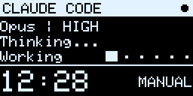
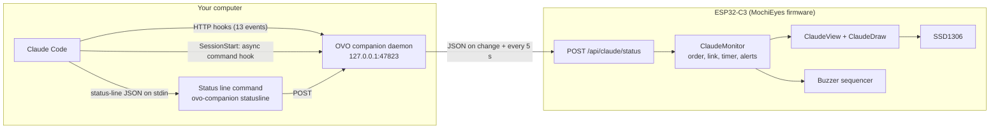
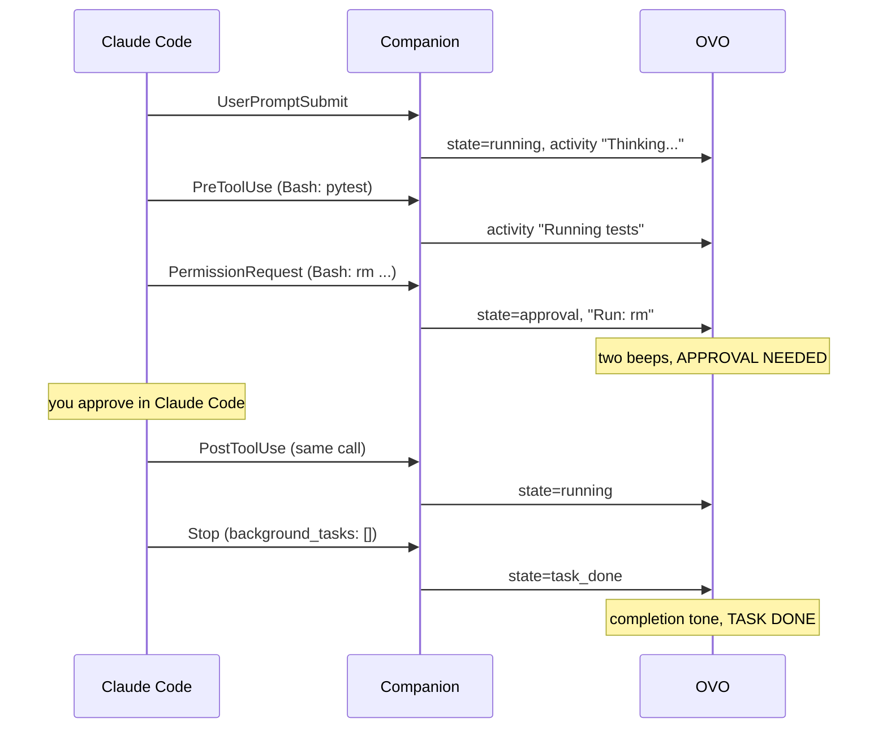

# Claude Code activity monitor

The third face on the OLED shows what [Claude Code](https://code.claude.com)
is doing on your computer: the model and effort, a short activity label, how
long the task has been running, the approval mode, and a warning with two
beeps when Claude Code needs your permission. This document covers the whole
feature: the companion on the computer, the protocol, the firmware side, and
how it was verified.

<p align="center">
  
</p>

<sub>Frames drawn by the firmware's own screen code and the real Adafruit GFX
library on a PC (`tools/preview/claude_screens.cpp`), shown at 3x scale. Not a
photo of the hardware.</sub>

- [Screens](#screens)
- [Architecture and data flow](#architecture-and-data-flow)
- [Claude Code integration](#claude-code-integration)
- [Firmware side](#firmware-side)
- [Install, run, remove](#install-run-remove)
- [Configuration](#configuration)
- [Troubleshooting](#troubleshooting)
- [Security and privacy](#security-and-privacy)
- [Verification](#verification)
- [Limitations](#limitations)

## Screens


| Screen | When | Shows |
| ------ | ---- | ----- |
| Running | a prompt is being worked on | model and effort, activity, animated "Working..." scanner, task timer, approval mode |
| Approval needed | Claude Code waits for a permission decision | blinking header, warning triangle, a sanitised action ("Run: npm", "Edit: main.cpp"), task timer, approval mode |
| Task done | Claude stopped and Claude Code reported no running background work | tick, model and effort, how long the task took |
| Turn done | Claude stopped, but background work is still running, the turn was interrupted, or the Claude Code version does not report background work | same layout as Task done |
| Failed | the turn ended with an API error (`StopFailure`) | the error type ("Rate limited", "API overloaded") and the time |
| Ready / Idle | a session is open and waiting for a prompt / the companion has no session | model and effort / "No active session" |
| Ended | the session ended (`SessionEnd`) | session length; replaced after 60 s |
| Stale | no message from the companion for the stale timeout (15 s by default) | how long ago the last update was, and the last activity labelled "Last:" |
| Offline | the companion said goodbye when it stopped | "DISCONNECTED" |
| Waiting | nothing received since boot | the device's IP address, to configure the companion |

A tap on the pad switches between the screen and a details page (link state,
session id, raw permission mode, last hook event, time since the last update,
which alerts are on). Holding the pad for 5 seconds moves to the next face.

Approval modes are labelled from Claude Code's actual `permission_mode` value,
never inferred:

| `permission_mode` | Label | Meaning (from the Claude Code docs) |
| ----------------- | ----- | ----------------------------------- |
| `default` | MANUAL | Claude Code asks before edits, commands and network access |
| `auto` | AUTO | a classifier reviews actions instead of you |
| `plan` | PLAN | read-only exploration |
| `acceptEdits` | EDITS | file edits and common filesystem commands run without asking |
| `dontAsk` | DONTASK | only pre-approved tools run; everything else is denied |
| `bypassPermissions` | BYPASS | no permission checks |
| anything else | OTHER | a mode this version of the companion does not know |

Only `auto` is shown as AUTO. A missing permission prompt never implies
automatic approval.

## Architecture and data flow



1. **Claude Code** fires hooks. Thirteen events go to the companion as HTTP
   hooks. `SessionStart` accepts only command hooks, so it runs the forwarder
   `ovo-companion hook` asynchronously. The status-line command receives the
   model's display name and the live effort level.
2. **The companion** keeps one record per session (`tracker.py`). It turns
   events into a state and a short label, picks the primary session, and
   measures time with a monotonic clock.
3. **The sender thread** posts a compact JSON status to the device whenever the
   displayed state changes, and every 5 seconds as a heartbeat. Failed sends
   back off from 0.5 s to 30 s; only the newest state is ever sent.
4. **The firmware** validates the message, ignores out-of-order ones
   (`seq`), keeps the task timer ticking locally between messages, marks the
   link stale when messages stop, and plays an alert on state transitions.



The protocol (`POST /api/claude/status`) is specified in [API.md](API.md#claude-code-status).

## Claude Code integration

Verified against **Claude Code 2.1.296** (see [Verification](#verification)).
Sources: [hooks reference](https://code.claude.com/docs/en/hooks),
[status line](https://code.claude.com/docs/en/statusline),
[permission modes](https://code.claude.com/docs/en/permission-modes).

### Hook events

| Event | Effect on the session |
| ----- | --------------------- |
| `SessionStart` | session opens: Ready ("Starting session"); model id if reported. Never resets a session that is already working (it is async and can arrive late; `compact` fires mid-task) |
| `UserPromptSubmit` | Running, "Thinking...", task timer restarts |
| `PreToolUse` | Running, label from the tool ("Reading files", "Searching code", "Editing code", "Running tests", "Building", "Running command", "MCP: github", ...) |
| `PostToolUse` | back to "Thinking..."; closes the approval for that call |
| `PostToolUseFailure` | "Tool failed"; with `is_interrupt` the turn ends as Turn done, "Interrupted" |
| `PermissionRequest` | Approval needed, with a sanitised action |
| `PermissionDenied` (auto mode) | "Action denied", approval closed |
| `Notification` | `permission_prompt` opens an approval if `PermissionRequest` has not; `idle_prompt` ends a turn that never got a `Stop` (Esc); elicitations show "Input needed"; all others change nothing |
| `Stop` | Task done if `background_tasks` is present and nothing in it is running; otherwise Turn done |
| `StopFailure` | Failed, with the error type |
| `SubagentStart` / `SubagentStop` | activity only; a subagent finishing is never task completion |
| `SessionEnd` | Ended; later events for that session are ignored until a new `SessionStart` |
| `PostModelSwitch` | new model id (the status line then supplies the display name) |

Each event's `permission_mode` updates the approval mode. Its `effort.level`
updates the effort only when present: many events carry none, and absence
never clears or guesses a value.

### Model and effort

The status line is the source of the model's display name (`model.display_name`,
for example "Opus") and of the live effort (`effort.level`, which follows
mid-session `/effort` changes). The documented effort values are `low`,
`medium`, `high`, `xhigh` and `max`. Anything else, such as "ultra", is
rejected by both the companion and the firmware. When the status line omits
`effort`, the current model has no effort setting and the OLED shows none.
Effort is never derived from the model name.

Without a status line (headless `claude -p` runs), the model id from
`SessionStart` or `PostModelSwitch` is reformatted ("claude-opus-4-7" becomes
"Opus 4.7"). If neither reports one, the OLED shows "Model --". In Claude Code
2.1.296, `SessionStart` in `-p` mode carried no `model` field.

The installer keeps any status line you already had. It records the old
command, and the OVO status line runs it with the same input and prints its
output. With no previous status line, it prints `OVO ● | Opus | high`, where
the dot shows the path to the device: filled means online, hollow means the
device is unreachable, and dotted means the companion is not running.

### Turn, task and session

* **Turn done**: Claude stopped responding. Something may still be pending:
  background shells or agents were running at `Stop`, the turn was
  interrupted, or the Claude Code version did not report background work.
* **Task done**: `Stop` reported `background_tasks` and none was running, so
  nothing more happens until you write again. Claude may still have ended with
  a question for you; the device cannot know that.
* **Session ended**: `SessionEnd`, a separate state with its own screen.

### Several sessions

Each `session_id` is tracked separately. The OLED shows one primary session,
chosen deterministically:

1. a session waiting for approval; the one that has waited longest wins;
2. otherwise the current primary, while it is still running;
3. otherwise the running session with the most recent event;
4. otherwise the session with the most recent event.

Ties go to the higher `session_id`. The header shows the count ("CLAUDE CODE
x2"); the other sessions are visible in `ovo-companion status`.

### Ordering, duplicates, staleness

* HTTP hooks arrive in order. The async `SessionStart` may arrive late, and
  never resets a working session.
* An identical payload within 10 seconds is dropped (the same handler
  installed twice, or a retry).
* A `PreToolUse` whose call already finished is dropped. A `PostToolUse` that
  arrives after the turn ended does not reopen it.
* Sessions with no events for 2 hours are forgotten (Claude Code exited
  without `SessionEnd`).
* Each message to the device carries an increasing `seq` and a per-run `cid`.
  The device ignores older messages, so a delayed retry cannot undo newer
  state.

## Firmware side

### Modes and touch

```
EYES --hold 5 s--> CLOCK --hold 5 s--> CLAUDE --hold 5 s--> EYES
```

`TouchGestures` reports `ModeHold` once per press, so a 15-second hold still
moves exactly one step (host-tested). Releasing re-arms it. Taps keep their
meaning on the eyes and clock. On the Claude face, one tap toggles the details
page. Claude status keeps updating, and alerts keep sounding, whichever face is
shown. When you come back to the Claude face it shows the latest state.

The web page has a third face button, a Claude Code panel with the live state
and the alert switches, and "Claude" as a start-up face. `mode claude` works
on the Serial console and in `/api/eye`.

### Link health and the timer

| Link | Cause | Screen |
| ---- | ----- | ------ |
| never | nothing received since boot | Waiting (shows the device IP) |
| live | a valid message within the stale timeout | the session's screen |
| stale | no message for `cc_stale` seconds (default 15; heartbeat is 5) | STALE, "No update for mm:ss", last activity marked "Last:" |
| closed | the companion sent `connected: false` on shutdown | OFFLINE / DISCONNECTED |

The task timer is anchored to `millis()` when a message arrives and keeps
counting between messages. It stops when the task is no longer running and
while the link is not live, so the device never shows RUNNING with a ticking
timer after the companion has gone.

### Buzzer alerts

| Alert | Pattern | Fires on | Setting (default) |
| ----- | ------- | -------- | ----------------- |
| Permission requested | two short beeps, 1760 Hz | entering approval; a second request within 4 s stays silent | `cc_perm` (on) |
| Completion | rising pair ending in one long 1568 Hz tone | running or approval -> turn done or task done, same session | `cc_done` (on) |
| Failure | two low beeps and a longer lower one | running or approval -> failed, same session | `cc_fail` (on) |
| Connection lost | falling two-note warning | live -> stale, once per loss | `cc_lost` (off) |

The 5-second heartbeat repeats the current state, so alerts are tied to
state transitions and never to individual messages. Alerts use the existing
non-blocking melody sequencer. A Claude alert waits for the current touch or
mode chirp to finish instead of cutting it off. The master Sound switch mutes
everything. No pins or wiring changed: the buzzer is still GPIO 2 and the
touch pad GPIO 1.

### Settings

Saved in NVS (namespace `terminal`, like the other settings) and changed from
the web page or `POST /api/settings`: `cc_perm`, `cc_done`, `cc_fail`,
`cc_lost` (0/1) and `cc_stale` (5-600 seconds).

## Install, run, remove

Full instructions: [companion/README.md](../companion/README.md). In short:

```sh
pip install -e companion                 # or run companion/ovo-companion.py directly
ovo-companion install                    # in your project: .claude/settings.local.json
ovo-companion run --device mochi.local   # keep running while you use Claude Code
ovo-companion uninstall                  # removes exactly what install added
```

`install --scope user` writes to `~/.claude/settings.json` instead, which
monitors every project. Network requirement: the computer must reach the
device on TCP port 80. The companion listens only on 127.0.0.1.

## Configuration

| Setting | Default | Where |
| ------- | ------- | ----- |
| Device host or IP | `mochi.local` (the firmware's mDNS name) | `--device`, `OVO_DEVICE`, config `device` |
| Device port | 80 | `--device-port`, `OVO_DEVICE_PORT`, `device_port` |
| Local receiver port | 47823 | `--port`, `OVO_PORT`, `listen_port`; pass the same `--port` to `install` |
| Heartbeat | 5 s | `--heartbeat`, `heartbeat_s` |
| Request timeout | 2 s | `timeout_s` |
| Longest retry gap | 30 s | `retry_max_s` |
| Forget silent sessions | 2 h | `session_expiry_s` |
| Stale timeout on the device | 15 s | web page, or `cc_stale` in `/api/settings` |

The config file is `%APPDATA%\ovo-companion\config.json` on Windows and
`~/.config/ovo-companion/config.json` elsewhere; see
[companion/config.example.json](../companion/config.example.json).

## Troubleshooting

| Symptom | Check |
| ------- | ----- |
| OLED says "Waiting for the companion" | Is `ovo-companion run` running? Does `ovo-companion send-test --device <ip>` reach it? Use the IP shown on that screen if `mochi.local` does not resolve |
| `send-test` says "the firmware has no /api/claude/status" | Flash the firmware from this version |
| OLED shows STALE | The companion stopped, the PC slept, or Wi-Fi dropped. It recovers on the next message |
| Status never changes from Ready | Hooks not installed in the project you are using (`.claude/settings.local.json`), or Claude Code was started before installing: start a new session |
| Model shows "Model --" | Normal in headless `-p` runs (no status line). Interactive sessions get it from the status line |
| Effort missing | The current model has no effort setting, so Claude Code reports none |
| The status line shows a hollow or dotted dot | Hollow: the device is unreachable. Dotted: the companion is not running |
| Hook errors in Claude Code when the companion is not running | HTTP hook connection failures are non-blocking; start the companion, or `ovo-companion uninstall` when you do not want the monitor |

`ovo-companion status` prints what the daemon sees: sessions, link, counters.
`ovo-companion run -v` logs every request.

## Security and privacy

* **Read-only with respect to authorization.** Hook replies are always `204
  No Content` (or a status-line reply), which Claude Code documents as "no
  decision". The companion never approves, denies or bypasses a permission
  request, and the installer never touches `permissions` or the permission
  mode (tested).
* **Nothing private reaches the device.** Only the companion's own labels
  are sent: state, tool category, model name, effort, mode, timers. Prompts,
  the assistant's messages, command arguments, file contents and paths are not
  sent. A shell command appears as its program name only ("Run: curl"); a file
  appears as its base name; a URL as its host. Tests check that a secret in a
  prompt, a command or the last assistant message never appears in what is
  sent.
* **No secrets in firmware.** No Anthropic API key or Claude credential is
  stored, needed or transmitted.
* **The receiver is local.** The daemon binds 127.0.0.1 and refuses requests
  with an `Origin` header or a browser form or plain-text content type, so a
  web page cannot feed it fake events.
* **The device endpoint has no authentication**, like the rest of the
  device's API. Anyone on your Wi-Fi can draw a fake status. See
  [SECURITY.md](../SECURITY.md).

## Verification

| Check | Command | Result |
| ----- | ------- | ------ |
| Firmware build, pinned toolchain (esp32 3.3.12, Adafruit SSD1306 2.5.17, GFX 1.12.6, ArduinoJson 7.4.3) | `arduino-cli compile --clean --warnings all ...` (arduino-cli 1.5.1) | 0 warnings; 1,370,041 B flash (69%), 48,856 B globals (14%); +18,890 B and +1,208 B against 1.0.0 rebuilt the same way |
| Firmware logic on a PC (mode cycle, 15 s hold, taps in every mode, protocol validation, ordering, staleness, timer, alerts, layouts) | `tests/host/test_claude.cpp` | 350 checks, 0 failures (MSVC 19.50, `/W4 /WX`) |
| Existing touch recognizer | `tests/host/test_touch.cpp` | 48 checks, 0 failures |
| Screens on the real font metrics | `tools/preview/claude_screens.cpp` | all lines fit; found and fixed one overlap (Ready screen) before release |
| Companion (parsing, tracker, protocol, device client, daemon end to end, installer, forwarders, CLI) | `python -m pytest companion/tests` | 154 passed (Python 3.11, Windows) |
| Real Claude Code 2.1.296, headless | `claude -p ... --model haiku` in a scratch project with the hooks installed, a fake device recording the messages | SessionStart, UserPromptSubmit, PreToolUse, PostToolUse, Stop and SessionEnd arrived and parsed (0 invalid); effort `medium` came from the payload; `Stop` carried `background_tasks: []` and showed Task done |
| Status line through Git Bash, as Claude Code runs it | the installed `statusLine.command` with sample JSON | printed `OVO ● \| Opus \| xhigh`; daemon recorded model and effort |
| Install and uninstall on a real Claude Code project | `ovo-companion install` / `uninstall` | 14 handlers and the status line added, then removed; the settings file the installer created was deleted again |

The real run found a problem the documentation reading had missed:
`SessionStart` does not accept HTTP hooks. The installer now uses an async
command hook for that one event.

### On hardware

Measured on 2026-10-13 on an ESP32-C3 with an SSD1306 at 0x3C on GPIO 20/21,
from a PC on the same Wi-Fi, by reading `/api/state`:

| Check | Result |
| ----- | ------ |
| Endpoint: valid, repeated and older `seq` | 200 `ok claude`, `ok repeated`, `ok outdated, ignored` |
| Endpoint: malformed JSON, `effort: "ultra"`, 33-char activity, `seq` as a string | 400, each naming the field |
| Endpoint: form content type, 2 KB body, `GET` | 415, 413, 404; the device kept running |
| Real Claude Code 2.1.296 session (`claude -p`, companion on the PC) | Ready, Running "Thinking..." (MANUAL), "Running command" with effort `medium`, "Thinking...", then Task done and Ended; 0 messages rejected |
| Companion killed without a goodbye | STALE about 15 s after the last heartbeat; timer frozen; device still responsive |
| Companion goodbye (`connected: false`) | DISCONNECTED immediately |
| Local timer | ticked 109 s to 114 s with no messages in between |
| Frame rate on the Claude face | 8.0 fps while animating (125 ms), 4.0 fps on static screens (250 ms), as designed |
| Free heap | about 155 KB at idle; lowest since boot 98.9 KB; fetch task stack 8,656 bytes unused |
| `/api/state` response time, 40 requests | 40 succeeded; median 47 ms, 90th percentile 107 ms, worst 994 ms |

Free heap dips by about 280 bytes per HTTP request and comes back within two
minutes (151.5 KB after rapid polling, 155.3 KB after 150 s idle): that is
lwIP keeping closed connections in TIME_WAIT, not a leak. In a headless run,
`SessionEnd` follows `Stop` within a fraction of a second, so Task done is on
screen only briefly; in an interactive session it stays until the next prompt.

Still to be checked by eye and ear on the device:

1. The three-face cycle with a real 5-second hold (a 15-second hold moves one
   face), and taps on each face.
2. `ovo-companion send-test --state approval`: two beeps, blinking header.
3. The completion tone and the failure warning.
4. Legibility of every screen on the physical panel.
5. An interactive session, where the status line supplies the model name.

## Limitations

* One primary session on screen; others are counted, not shown.
* Esc interrupts emit no `Stop`. The turn ends on the device when Claude Code
  sends `idle_prompt` (after about a minute of waiting), or at the next prompt.
* After you deny a permission request, Claude Code sends no hook; the approval
  screen stays until the next event, usually your next prompt.
* "Task done" cannot tell whether Claude ended with a question for you.
* Interactive permission prompts are not reachable in headless mode, so the
  approval path was verified with simulated events (documented payload
  shapes), not with a live prompt.
* Hook payloads are documented to evolve. Unknown events and fields are
  ignored, unknown permission modes show OTHER, and older or undetected Claude
  Code versions get command hooks and the core events only.
* The device endpoint is unauthenticated (see [SECURITY.md](../SECURITY.md)).
