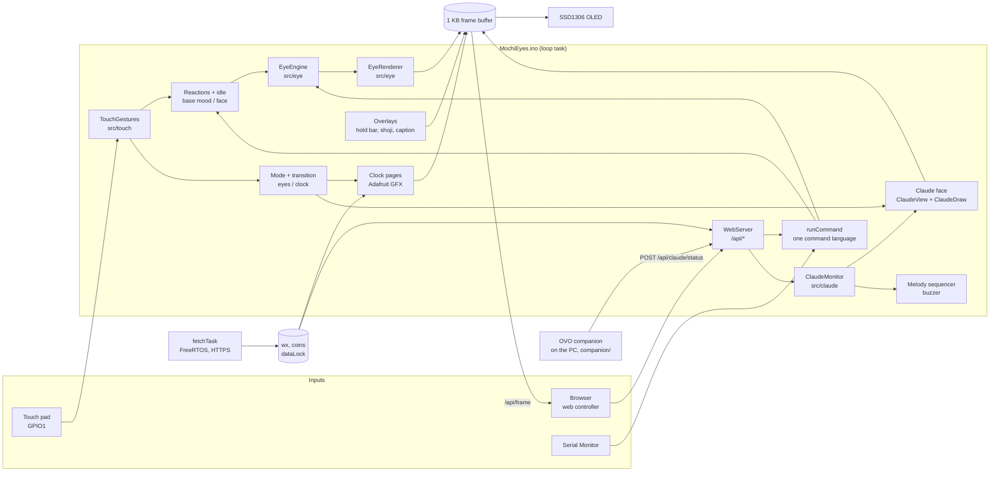
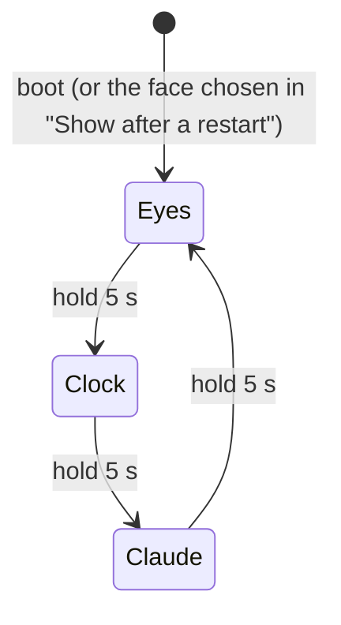
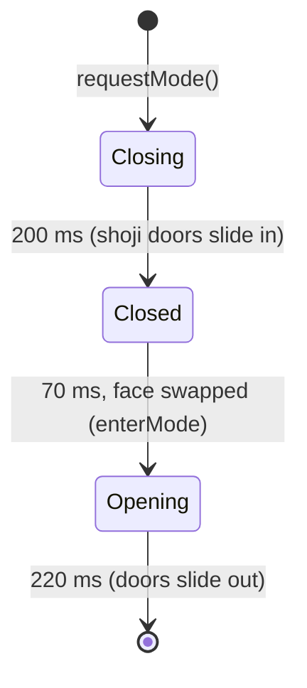

# MochiEyes design

This document explains how the firmware is put together and why. For the
individual decisions see the ADRs listed at the end; for the HTTP interface
see [API.md](API.md); for wiring see [HARDWARE.md](HARDWARE.md).

## Goals

1. **Feel alive.** The eyes never freeze, including during network requests,
   and they respond to touch within one frame.
2. **One device, three faces.** A companion (the eyes), a desk terminal (the
   clock pages) and a Claude Code activity monitor, switched with a deliberate
   5-second hold.
3. **Fit the ESP32-C3 SuperMini.** One RISC-V core at 160 MHz, about 320 KB
   RAM, 4 MB flash, no FPU.
4. **Teachable code.** Each layer can be read, and where possible tested, on
   its own.

Non-goals: authentication, multi-user control, battery operation.

## Architecture

The loop task owns the display, the engine, touch, the web server and the
Claude Code state. The fetch task owns the network clients. They share exactly
one thing, the downloaded weather and prices, behind a mutex. The Claude Code
companion runs on the computer, not on the device; see
[CLAUDE_MONITOR.md](CLAUDE_MONITOR.md).

### Layers

Paths are relative to `firmware/MochiEyes/`, the folder that is flashed.

| Layer | Files | Depends on Arduino? | Tested on PC? |
| ----- | ----- | ------------------- | ------------- |
| Eye behaviour (where to look, blinks, moods) | `src/eye/EyeEngine.*`, `BehaviorParams.h` | No | Builds and renders frames (`tools/preview/frames.cpp`) |
| Eye drawing (pixels into the buffer) | `src/eye/EyeRenderer.*`, `EyeGeometry.h` | No | Same |
| Text commands | `src/eye/EyeCommands.*` | No | Not yet |
| Touch gestures | `src/touch/TouchGestures.h` | No | 48 checks, 100% line coverage |
| Face order (eyes, clock, claude) | `src/app/AppModes.h` | No | `tests/host/test_claude.cpp` |
| Claude status: schema, ordering, link, timer, alerts, screen text | `src/claude/ClaudeStatus.h`, `ClaudeMonitor.h`, `ClaudeView.h` | No (ArduinoJson only) | `tests/host/test_claude.cpp`: 350 checks |
| Claude screen drawing | `src/claude/ClaudeDraw.h` | Adafruit GFX only | Rendered on a PC with the real library (`tools/preview/claude_screens.cpp`) |
| Controller page | `web/index.html` | No | Previewed with a mock API (`tools/preview/serve.py`) |
| Wiring, modes, network, web API | `MochiEyes.ino` | Yes | On hardware |
| Claude Code companion | `companion/` (outside the firmware) | No (Python) | 154 pytest tests |

## The main loop

`loop()` runs these steps every pass, none of which may block:

1. `server.handleClient()`: answer at most one HTTP request.
2. `pollSerial()`: read console commands.
3. `serviceTouch()`: feed the pad level to `TouchGestures`, act on the event.
4. `serviceSound()`: advance the note sequencer.
5. `serviceReaction()`, `serviceIdle()`, `serviceClaude()`, `runDemo()`: timed
   behaviour. `serviceClaude()` runs whichever face is shown: it notices when the
   companion goes quiet and queues Claude Code alerts.
6. Note page flipping, Wi-Fi reconnect, heartbeat log, pending restart.
7. If a frame is due, `renderFrame()`; otherwise `delay(1)` to yield the core.

A frame is due every 22 ms (`EYE_MAX_FPS` = 45) when the eyes are shown, a
transition is running or the pad is held, and every 250 ms on the clock
face. The Claude face draws every 125 ms while its loading animation runs and
every 250 ms otherwise, and skips the I2C transfer when the new frame is
identical to the last one sent (a 32-bit hash of the buffer). Any event that
changes the clock page or the Claude status sets `redrawNow` for an
immediate frame.

`renderFrame()` draws the face into the buffer, then overlays, then sends the
buffer once over I2C at 400 kHz. A 1 KB frame needs about 23 ms on the wire
at that speed (1024 bytes × 9 clocks ÷ 400 kHz), so the I2C bus, not the CPU, sets the
real ceiling on frame rate. The live value is reported in `/api/state` as
`sys.fps`.

## Modes and the transition

The order lives in `src/app/AppModes.h` (`nextMode()`), shared by the touch
pad, `/api/mode` and `mode` on the console. The web page and the console can
also jump straight to any face. Every change runs the same transition:

The doors are drawn by `drawShoji()`: two white "paper" panels with black
kumiko bars that move with the panel. The face is swapped while the doors
are closed, so the change is never visible as a jump. A hold that fires during
a transition advances from the face being opened, not the one being left.

## Touch

`TouchGestures` turns the pad into events (see
[ADR 0005](adr/0005-arduino-free-touch-gesture-recognizer.md) for the
timing rules). The sketch maps them per face:

| Event | Eyes | Clock | Claude |
| ----- | ---- | ----- | ------ |
| Press | Eyes widen slightly (instant feedback); counts as interaction | Counts as interaction | Counts as interaction |
| 1 tap | Glance toward the pad for 1.7 s | Next page | Details page / back |
| 2 taps | Smile at you for 2.6 s | Previous page | Back to the status |
| 3 taps | Angry side-eye at the pad, then a glare, 2.6 s | Clock face | Back to the status |
| 4+ taps | Dizzy for 2.6 s | Clock face | Back to the status |
| Hold (0.65 s) | Petting: heavy lids with a smile; on release, a short smile | (after 1.5 s a tick sounds) | |
| Hold released | | Refresh weather and prices, if held at least 1.5 s | |
| Hold 5 s | Switch to clock | Switch to Claude | Switch to eyes |
| Any tap or hold while asleep | Wake up, groggy for 3 s | | |

`ModeHold` fires once per press, so holding for 15 seconds still moves one
step; releasing re-arms it. A progress bar appears while the pad is held:
after 0.9 s on the clock and Claude faces (with a notch at the 1.5 s refresh
point on the clock) and after 1.8 s on the eyes, so a short pet does not show
it.

## Personality: base, reactions and idle

The user chooses a **base** mood and face (web page or console). Everything
else is temporary and returns to the base:

- **Reactions** (`startReaction`) override the engine for a set time. They
  are built only from public engine calls (`lookAt`, `setExpression`,
  `setMood`, `setArousal`, `setSleeping`), with one exception: *dizzy*
  copies the engine's `FaceState` and replaces the gaze with two
  opposite-direction orbits before rendering, so blinks and lids stay natural
  while the eyes spin. The engine source is unchanged.
- **Idle** (`serviceIdle`): with auto-sleep on, 2 minutes without interaction
  sets the mood to sleepy, and 5 minutes closes the eyes. A touch or any web
  action resets it; polling the page does not.
- **Commands** (`runCommand`) restore the base before running, then store the
  result as the new base, so a mood change never inherits a reaction's face.

## Concurrency

See [ADR 0003](adr/0003-network-fetches-in-a-freertos-task.md). Summary:

| Data | Written by | Read by | Guard |
| ---- | ---------- | ------- | ----- |
| `wx`, `coins` | fetch task | clock pages, `/api/state` | `dataLock` mutex (`DataLock` RAII helper) |
| `fetchBusy`, `fetchForce`, `lastWeatherOk`, `lastCryptoOk` | both | both | `volatile`, single-word writes |
| `claudeMon`, the Claude body buffer and alert queue | `/api/claude/status` handler (loop task) | renderer, `serviceClaude()`, `/api/state` (loop task) | none needed |
| everything else | loop task only | loop task only | none needed |

The Claude Code status arrives over HTTP, but `WebServer` runs its handlers
inside `server.handleClient()` in the loop task, so it never races the
renderer. Parsing a message of about 300 bytes takes well under a millisecond.
The companion on the computer is multi-threaded (receiver and sender) and
guards its tracker with a lock.

## Memory and flash budget

Measured with arduino-cli, ESP32 core 3.3.12, `esp32c3`,
`CDCOnBoot=cdc,PartitionScheme=min_spiffs`:

| Item | Size |
| ---- | ---- |
| Firmware (flash) | 1,370,041 of 1,966,080 bytes (69%) |
| Static RAM (globals) | 48,856 of 327,680 bytes (14%) |
| Web page in flash | 14,472 bytes (gzipped from 43,855) |
| Frame buffer | 1,024 bytes (heap) |
| Fetch task stack | 12,288 bytes (heap) |
| Claude request body | 1,025 bytes (static, part of the globals above) |

The Claude Code mode added 18,890 bytes of flash and 1,208 bytes of globals,
measured against the 1.0.0 sources rebuilt with the same toolchain. While a
`/api/claude/status` request is handled, WebServer briefly allocates its
1.4 KB raw-body chunk buffer and ArduinoJson a document of a few hundred
bytes; both are freed when the reply is sent.

Runtime heap and the fetch task's unused stack are reported live in
`/api/state` (`sys.heap`, `sys.minHeap`, `sys.fetchStackFree`) and on the
Status panel. They have not yet been recorded on hardware for this document.

## Web controller design

The page is designed as indigo-dyed cloth (*aizome*): light mode is the first,
palest dip (*kamenozoki*), dark mode is the deep *kon*.

| Token | Light | Dark | Used for |
| ----- | ----- | ---- | -------- |
| `--field` | `#e3ebee` | `#12203a` | Background cloth |
| `--ink` | `#132139` | `#ede6d4` | Text, outlines, the ensō |
| `--ink-2` | `#4a5a6f` | `#a8b2c3` | Secondary text |
| `--stitch` | ink at 42% | ink at 36% | Sashiko dividers, hitomezashi hem |
| `--shu` | `#c13b27` | `#dc4a33` | Seal ink: selected states, live signal, gaze dot, focus ring |

- **Type:** Shippori Mincho B1 for headings and kanji, Zen Kaku Gothic New for
  interface text, with system Mincho/Gothic fallbacks offline.
- **Structure:** running-stitch dividers mark panel boundaries; each panel has
  a vertical (*tategaki*) kanji label in the margin.
- **State as seal ink:** an inked vermilion seal means selected. Round seals
  are moods (behaviour), square seals are faces (eyelid shape).
- **One bold element:** the ensō gaze pad, drawn once on load as a brush
  stroke, with the live OLED mirror inside it.
- **Quality floor:** works from 320 px wide, keyboard-operable gaze pad
  (arrow keys, Escape), visible focus, `prefers-reduced-motion` respected,
  no blocking dialogs (Wi-Fi changes use a two-tap confirm).

The ensō and the stitch pattern are generated procedurally (variable-width
brush polygon revealed by an animated mask, and a hitomezashi tile used as a
CSS mask so it follows the theme colour).

## Decision records

| ADR | Decision |
| --- | -------- |
| [0001](adr/0001-merge-into-one-firmware.md) | Merge the clock and the eyes into one firmware |
| [0002](adr/0002-one-display-library-shared-frame-buffer.md) | One display library, one shared frame buffer |
| [0003](adr/0003-network-fetches-in-a-freertos-task.md) | Network fetches run in a FreeRTOS task |
| [0004](adr/0004-minimal-spiffs-partition.md) | Use the Minimal SPIFFS partition scheme |
| [0005](adr/0005-arduino-free-touch-gesture-recognizer.md) | An Arduino-free, unit-tested touch gesture recognizer |
| [0006](adr/0006-gzipped-web-ui-in-flash.md) | The web page is authored as HTML and embedded gzipped |
| [0007](adr/0007-credentials-in-gitignored-secrets-header.md) | Credentials live in a git-ignored `secrets.h` |
| [0008](adr/0008-claude-code-monitor-through-a-local-companion.md) | Monitor Claude Code through a local companion and supported hooks |
| [0009](adr/0009-device-trusts-a-summary-and-guards-its-own-freshness.md) | The device draws a validated summary and guards its own freshness |
| [0010](adr/0010-claude-screens-drawn-by-code-that-also-runs-on-a-pc.md) | Claude screens are drawn by code that also runs on a PC |
